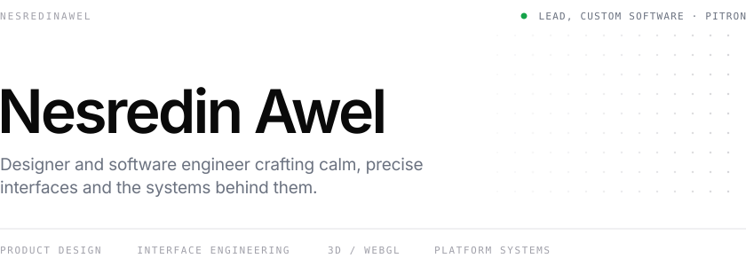
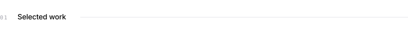
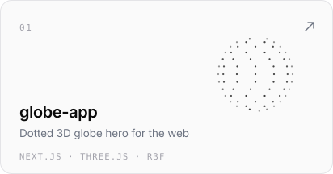
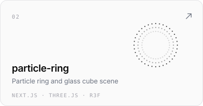
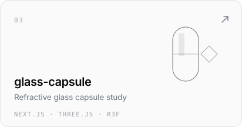
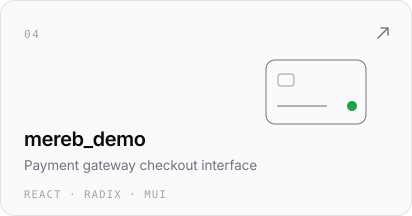
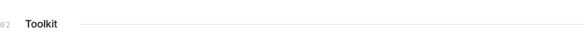
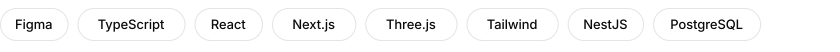
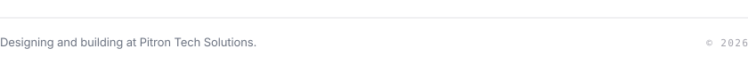

<picture>
  <source media="(prefers-color-scheme: dark)" srcset="assets/header-dark.svg">
  
</picture>

  

<picture>
  <source media="(prefers-color-scheme: dark)" srcset="assets/work-dark.svg">
  
</picture>

<a href="https://github.com/Nesredinawel/globe-app"><picture><source media="(prefers-color-scheme: dark)" srcset="assets/card-globe-app-dark.svg"></picture></a>&nbsp;<a href="https://github.com/Nesredinawel/particle-ring"><picture><source media="(prefers-color-scheme: dark)" srcset="assets/card-particle-ring-dark.svg"></picture></a>
<a href="https://github.com/Nesredinawel/glass-capsule"><picture><source media="(prefers-color-scheme: dark)" srcset="assets/card-glass-capsule-dark.svg"></picture></a>&nbsp;<a href="https://github.com/Nesredinawel/mereb_demo"><picture><source media="(prefers-color-scheme: dark)" srcset="assets/card-mereb_demo-dark.svg"></picture></a>

 

<picture>
  <source media="(prefers-color-scheme: dark)" srcset="assets/stack-dark.svg">
  
</picture>

<picture>
  <source media="(prefers-color-scheme: dark)" srcset="assets/tools-dark.svg">
  
</picture>

  

<picture>
  <source media="(prefers-color-scheme: dark)" srcset="assets/footer-dark.svg">
  
</picture>
